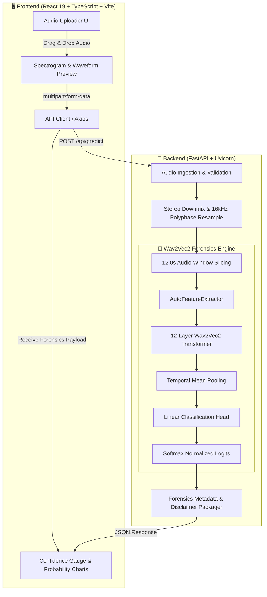

<div align="center">

# 🎙️ VoiceProof
### AI Voice Deepfake & Synthetic Speech Forensics Platform

[](https://fastapi.tiangolo.com)
[](https://react.dev)
[](https://www.typescriptlang.org)
[](https://pytorch.org)
[](https://huggingface.co/docs/transformers)
[](https://tailwindcss.com)
[](https://hacktoberfest.com)
[](LICENSE)

<p align="center">
  <strong>Production-grade audio forensics powered by fine-tuned Facebook Wav2Vec2 neural representations.</strong><br>
  Detect cloned voices, synthetic TTS, and audio deepfakes with real mathematical softmax certainty.
</p>

<p align="center">
  <a href="#-key-features">Key Features</a> •
  <a href="#-system-architecture">Architecture</a> •
  <a href="#-model-specifications">Model Specs</a> •
  <a href="#-quickstart-guide">Quickstart</a> •
  <a href="#-api-specification">API Reference</a> •
  <a href="#-ml-forensics-policy">ML Policy</a> •
  <a href="#-contributing">Contributing</a>
</p>

---

</div>

## 🌟 Overview

**VoiceProof** is an end-to-end full-stack audio forensics application designed to distinguish authentic human speech from AI-synthesized clones and neural deepfakes (ElevenLabs, Tortoise, VITS, StyleTTS, etc.).

Unlike superficial mock detectors that return random percentages or simulated telemetry, VoiceProof runs **genuine deep learning inference**:
- Audio waveforms are downmixed, polyphase-resampled to 16 kHz, and segmented into standardized temporal tensors.
- Features are extracted and passed through fine-tuned **Facebook Wav2Vec2** self-attention transformer layers.
- Raw model logits are normalized through a softmax function to provide calibrated posterior probabilities for **Original** vs. **AI-generated** classifications.

> [!IMPORTANT]
> **Strict Machine Learning Integrity**: VoiceProof **never** simulates or hardcodes detection probabilities. All forensic scores are calculated in real time by the neural network weights.

---

## ⚡ Key Features

| Capability | Description |
| :--- | :--- |
| **🧠 Real Neural Forensics** | Utilizes fine-tuned `facebook/wav2vec2-base` audio representation models for authentic feature extraction. |
| **⚡ High-Precision Resampling** | Automatic polyphase resampling to 16,000 Hz and intelligent stereo-to-mono downmixing via `scipy` and `soundfile`. |
| **🛡️ Calibrated Classifications** | Two-class output (`Original` vs `AI-generated`) with raw softmax probabilities and entropy-driven confidence analysis. |
| **💻 CPU / CUDA Dual Engine** | Auto-detects NVIDIA CUDA GPUs with graceful, non-crashing fallback to multi-threaded CPU inference. |
| **🎨 Dark Modern Cyber HUD** | Built with React 19, TypeScript, Tailwind CSS v4, Lucide icons, and Recharts latency and architecture visualizers. |
| **🧪 Battle-Tested Backend** | FastAPI server with complete test suites (`pytest`), lifespan model warming, and strict CORS origins. |

---

## 🏗️ System Architecture



---

## 🔬 Model Specifications

| Parameter | Specification |
| :--- | :--- |
| **Base Architecture** | `facebook/wav2vec2-base` |
| **Checkpoints** | Custom fine-tuned weights for acoustic artifact & synthetic phase detection |
| **Target Classes** | `0`: **Original** (Authentic human voice)<br>`1`: **AI-generated** (Synthetic / cloned speech) |
| **Target Sample Rate** | `16,000 Hz` (Standardized for speech classification) |
| **Audio Channels** | `Mono` (Stereo audio automatically downmixed via mean channel reduction) |
| **Window Duration** | Up to `12.0 seconds` (`192,000` samples) |
| **Model Weight Decoupling** | Heavy weight binaries (`*.safetensors`, `*.bin`, `*.pt`) decoupled from Git via `.gitignore` |

---

## 📂 Repository Structure

```text
voiceproof/
├── frontend/                         # React 19 + TypeScript + Vite 6 Application
│   ├── src/
│   │   ├── components/
│   │   │   ├── AudioUploader.tsx     # Audio dropzone with real-time file validation
│   │   │   ├── Header.tsx            # Navigation, branding & live service status indicator
│   │   │   ├── ModelStatusBanner.tsx # Live API readiness & hardware compute indicator
│   │   │   ├── PipelineCard.tsx      # Audio preprocessing & neural pipeline breakdown
│   │   │   └── SystemConfigCard.tsx  # Device specs, limits, & CORS configuration
│   │   ├── services/
│   │   │   └── api.ts                # Strongly-typed API client for predictions & health
│   │   ├── App.tsx                   # Primary Forensics Dashboard
│   │   └── index.css                 # Tailwind v4 styling & dark forensics tokens
│   ├── package.json                  # NPM scripts and frontend dependencies
│   └── vite.config.ts                # Vite 6 configuration & path aliases
│
├── backend/                          # FastAPI Production Server
│   ├── main.py                       # FastAPI application, lifespan warming & routes
│   ├── model_service.py              # Wav2Vec2 forensics service & audio preprocessing
│   ├── config.py                     # Path resolution, device selection, and CORS rules
│   ├── requirements.txt              # Core web server dependencies
│   ├── requirements-ml.txt           # Deep learning dependencies (PyTorch, Transformers)
│   ├── test_api.py                   # Pytest test suite (6 unit & integration tests)
│   ├── .env.example                  # Environment configuration template
│   └── README.md                     # Backend service documentation
│
├── model/                            # Model Checkpoint Directory
│   ├── config.json                   # Architecture & classification label mapping
│   ├── preprocessor_config.json      # Wav2Vec2 feature extraction settings
│   ├── model.safetensors             # Fine-tuned classification weights (~378 MB, gitignored)
│   └── README.md                     # Model placement and Hugging Face guide
│
├── .gitignore                        # Strict rules excluding binaries, venvs & .env
├── LICENSE                           # MIT License
└── README.md                         # Project documentation
```

---

## 🚀 Quickstart Guide

### 📋 Prerequisites
- **Node.js**: v20.x or higher (`node -v`)
- **Python**: 3.10 to 3.13 (`python --version`)
- **Git**: Installed and configured

---

### Step 1: Clone the Repository

```bash
git clone https://github.com/GamerxD01/voiceproof.git
cd voiceproof
```

---

### Step 2: Set Up & Run the Backend

#### Windows (PowerShell)
```powershell
cd backend

# Create and activate virtual environment
python -m venv .venv
.\.venv\Scripts\Activate.ps1

# Install core dependencies
pip install -r requirements.txt

# (Optional for ML inference) Install PyTorch and Transformers
# For CPU:
pip install torch torchvision torchaudio
pip install -r requirements-ml.txt

# Run the test suite
pytest -v test_api.py

# Start the FastAPI server
uvicorn main:app --reload --host 127.0.0.1 --port 8000
```

#### Linux / macOS (Bash)
```bash
cd backend

python3 -m venv .venv
source .venv/bin/activate

pip install -r requirements.txt
pip install -r requirements-ml.txt

pytest -v test_api.py
uvicorn main:app --reload --host 127.0.0.1 --port 8000
```

- **API Base**: `http://127.0.0.1:8000`
- **Interactive Swagger Docs**: `http://127.0.0.1:8000/docs`
- **Health Check**: `http://127.0.0.1:8000/api/health`

---

### Step 3: Set Up & Run the Frontend

In a new terminal window:

```bash
cd frontend

# Install dependencies
npm install

# Start Vite development server
npm run dev
```

Open your browser and navigate to **`http://localhost:5173`**.

---

## 📡 API Specification

### `GET /api/health`
Checks backend availability, compute hardware, and model readiness.

#### Example Response:
```json
{
  "status": "online",
  "service": "VoiceProof Audio Forensics API",
  "version": "1.0.0",
  "model_installed": true,
  "model_ready": true,
  "model_name": "Facebook Wav2Vec2 Audio Deepfake Classifier",
  "device": "cpu",
  "device_requested": "cpu",
  "message": "Model loaded and ready for real inference on cpu."
}
```

---

### `POST /api/predict`
Accepts an audio file and executes deepfake detection inference.

- **Content-Type**: `multipart/form-data`
- **Supported Formats**: `.wav`, `.mp3`, `.flac`, `.ogg`, `.m4a`
- **Max File Size**: 25 MB

#### cURL Example:
```bash
curl -X POST "http://127.0.0.1:8000/api/predict" \
  -H "accept: application/json" \
  -H "Content-Type: multipart/form-data" \
  -F "audio_file=@sample_speech.wav"
```

#### Example Response:
```json
{
  "status": "success",
  "model_ready": true,
  "filename": "sample_speech.wav",
  "predicted_class": "AI-generated",
  "predicted_label": "AI-generated",
  "confidence": 0.9418,
  "probabilities": {
    "Original": 0.0582,
    "AI-generated": 0.9418
  },
  "audio_metadata": {
    "original_sample_rate": 44100,
    "original_duration_seconds": 9.4,
    "processed_sample_rate": 16000,
    "processed_duration_seconds": 9.4,
    "channels": "mono (converted from stereo)",
    "truncated": false,
    "max_duration_seconds": 12.0
  },
  "device": "cpu",
  "disclaimer": "VoiceProof classification reflects statistical model confidence from fine-tuned Facebook Wav2Vec2 representations. Confidence scores indicate acoustic pattern alignment and do not constitute an absolute legal or forensic guarantee of authenticity."
}
```

---

## ⚖️ ML Forensics & Authenticity Policy

1. **No Simulated Probabilities**: Detection outcomes are the direct result of forward passes through deep neural representations.
2. **Transparent Limitations**: Acoustic classifiers can be influenced by microphone distortion, heavy codec compression, or background noise. High confidence scores signify statistical alignment with synthetic speech distributions rather than an infallible guarantee.
3. **Privacy First**: Uploaded audio files are processed in memory and never persisted or shared to external third-party servers.

---

## 🤝 Contributing

Contributions are warmly welcomed, especially during **Hacktoberfest**!

1. Fork the project: `https://github.com/GamerxD01/voiceproof/fork`
2. Create your feature branch: `git checkout -b feature/awesome-forensics-feature`
3. Commit your changes: `git commit -m 'feat: Add spectral centroid feature analysis'`
4. Push to the branch: `git push origin feature/awesome-forensics-feature`
5. Open a Pull Request!

---

## 📄 License

Distributed under the **MIT License**. See [`LICENSE`](LICENSE) for more details.

---

<div align="center">
  <sub>Built with ❤️ by <a href="https://github.com/GamerxD01">Chandra Prakash</a> for Hacktoberfest 2026.</sub>
</div>
